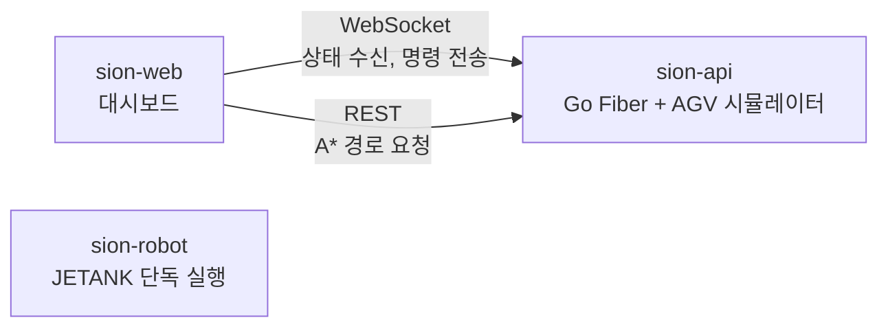

# Sion API

> AGV 관제 서버와 데모용 AGV 시뮬레이터

Go 1.25 · Fiber v2 · WebSocket · 데모 https://sion.tolelom.xyz



Sion은 LoL 챔피언 사이온의 궁극기(목표를 향한 직선 돌진)를 Jetson 기반 AGV로 옮긴 프로젝트입니다. AGV는 맵에서 적을 찾아 장애물을 피해 접근한 뒤 직선 구간에서 가속해 돌진합니다. 데모에서는 sion-api 안의 시뮬레이터가 AGV 역할을 하고, 실제 로봇 코드인 [sion-robot](https://github.com/tolelom/sion-robot)은 JETANK에서 단독으로 돌며 서버와 연결되지 않습니다.

## 기능

- 대시보드 WebSocket `/websocket/web`: 접속하면 시스템 정보와 맵 전송, 이후 상태·위치 브로드캐스트
- 긴급 정지, 자동/수동 모드 전환, 경로 이동, 초기화 명령
- 경로 탐색 `POST /api/pathfinding`, 상태 확인 `GET /api/health`
- 내장 AGV 시뮬레이터: 자동 모드에서 탐지 범위 안의 가장 약한 적에게 돌진, 수동 모드에서 받은 경로 추종, 이동하면 배터리 감소
- 모든 접속자가 시뮬레이터 하나를 같이 조작
- 메시지 크기·명령 빈도·요청 본문 한도와 Origin 검사

## 시작하기

Go 1.25가 필요합니다.

```bash
git clone https://github.com/tolelom/sion-api.git
cd sion-api
go run .
```

| 접속 | 주소 |
|---|---|
| 대시보드 WebSocket | `ws://localhost:8001/websocket/web` |
| 상태 확인 | http://localhost:8001/api/health |

설정은 환경 변수 `PORT`(기본 `8001`)와 `ALLOWED_ORIGINS`(CORS·WebSocket Origin 허용 목록, 쉼표 구분, 기본 `http://localhost:5173`)로 넘기고, `.env` 파일은 읽지 않습니다.

## 문서

| 문서 | 내용 |
|---|---|
| `ARCHITECTURE.md` | 저장소 역할과 코드 지도 |

## 기여

개발 명령, 계약 변경 절차, 배포 흐름은 `CONTRIBUTING.md`에 있습니다.
