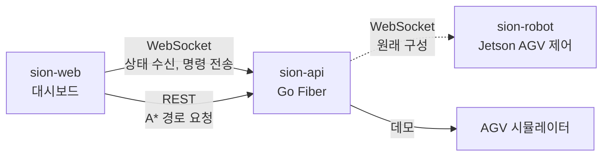

# Sion API

> AGV 관제 서버와 데모용 AGV 시뮬레이터

Go 1.25 · Fiber v2 · WebSocket · 데모 https://sion.tolelom.xyz

## 개요

Sion은 LoL 챔피언 사이온의 궁극기(목표를 향한 직선 돌진)를 Jetson 기반 AGV로 옮긴 프로젝트다. AGV는 맵에서 적을 찾아 장애물을 피해 접근한 뒤 직선 구간에서 가속해 돌진한다.

이 저장소는 대시보드와 AGV 사이의 서버다. 대시보드에 WebSocket으로 AGV 상태를 보내고 명령을 받으며, REST로 A* 경로 탐색을 제공한다.

지금은 공개 데모 모드로 동작한다. 실제 AGV 대신 서버 안의 시뮬레이터가 AGV 역할을 하고, 모든 방문자가 시뮬레이터 하나를 같이 조작한다. 데모로 바꾸면서 LLM 해설·채팅, MySQL 로그 저장, 실제 AGV 연결을 뺐다. 이 코드는 git 이력에 남아 있다.

## 시스템 구성



| 저장소 | 역할 |
|---|---|
| [sion-web](https://github.com/tolelom/sion-web) | 관제 대시보드 |
| sion-api | A* 경로 탐색, 데모용 AGV 시뮬레이터. 원래 구성에서는 AGV와 대시보드 사이 상태 중계(이 저장소) |
| [sion-robot](https://github.com/tolelom/sion-robot) | AGV 제어. 경로 계획, 경로 추종, 적 돌진 |

## 기능

- WebSocket `/websocket/web`: 접속 때 시스템 정보와 맵(장애물) 전송, 이후 상태·위치 브로드캐스트
- 명령 처리: 긴급 정지, 자동/수동 모드 전환, 경로 이동, 초기화
- A* 경로 탐색 `POST /api/pathfinding`, 상태 확인 `GET /api/health`
- 시뮬레이터: 20x20 맵, 자동 모드에서 탐지 범위 안의 적 중 HP가 가장 낮은 적에게 돌진, 수동 모드에서 받은 경로 추종, 이동에 따른 배터리 소모
- 접속자가 없으면 시뮬레이션 틱을 건너뜀
- 남용 방지: WebSocket 메시지 32KB, 연결당 명령 초당 5회(버스트 10), 요청 본문 64KB, Origin 검사

## 구조

| 경로 | 책임 |
|---|---|
| `main.go` | 앱 구성: 라우트, CORS, 본문 한도, 시뮬레이터 시작, 종료 신호 처리 |
| `handlers/websocket_web.go` | 대시보드 WebSocket: 접속 메시지, 명령 수신, 명령 속도 제한 |
| `handlers/ws_keepalive.go` | ping/pong keepalive |
| `handlers/pathfinding.go` | `POST /api/pathfinding` 요청 검증과 A* 호출 |
| `services/simulator.go` | AGV 시뮬레이터: 수명주기, 틱 루프, 브로드캐스트 메시지 |
| `services/simulator_commands.go` | 시뮬레이터 WebSocket 명령 처리 |
| `services/simulator_behavior.go` | 적 탐지·돌진, 경로 추종, 배터리 소모 |
| `services/simulator_world.go` | 장애물·적 생성 |
| `services/client_manager.go` | 접속 관리, 쓰기 타임아웃, 브로드캐스트 |
| `algorithms/astar.go` | 격자 A* |
| `models` | 메시지, 상태, 맵 타입 |

## 실행

Go 1.25가 필요하다.

```bash
git clone https://github.com/tolelom/sion-api.git
cd sion-api

go run .
```

서버는 `.env` 파일을 읽지 않는다. 설정은 환경 변수로 넘긴다.

| 변수 | 기본값 | 용도 |
|---|---|---|
| `PORT` | `8001` | 서버 포트 |
| `ALLOWED_ORIGINS` | `http://localhost:5173` | CORS와 WebSocket Origin 허용 목록(쉼표 구분) |

| 명령 | 용도 |
|---|---|
| `go run .` | 개발 실행 |
| `go test -race ./...` | 테스트 |
| `go vet ./...` | 정적 검사 |
| `GOOS=linux GOARCH=arm64 CGO_ENABLED=0 go build -o server .` | 컨테이너용 바이너리(`Dockerfile`이 `server`를 복사) |
